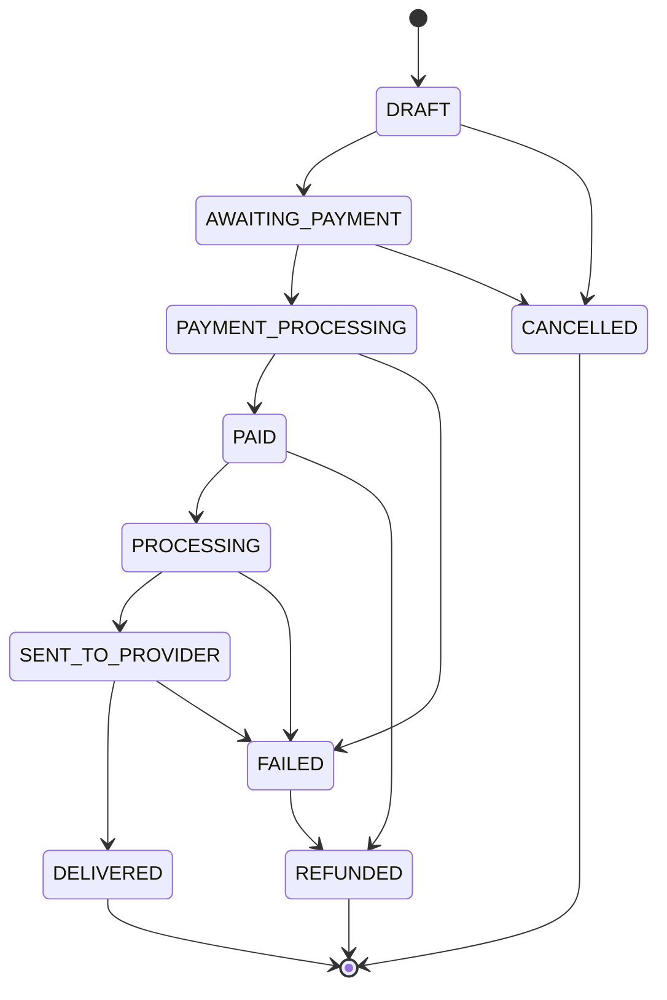

# App Transfer

[](https://github.com/anderson-fullstack-developer/app-transfer/actions/workflows/ci.yml)


**Money transfers from families to students, simple and traceable.** Built for students from São Tomé and Príncipe studying in Morocco: a relative finds the student by `@username`, picks an amount in EUR, sees the EUR → MAD quote with the fee, confirms, and both follow the transfer until it is delivered.

> **SIMULATION mode.** No real money moves. Every payment goes through a `MockPaymentProvider`, and the architecture is ready to plug in a licensed partner (Wise, Nium, Thunes) without changing the domain.

**Live demo (front-end):** [marrocospay.vercel.app](https://marrocospay.vercel.app)


## Features

- **Student onboarding** with a unique `@username`
- **Student search** by the sender, with confirmation of the right person
- **Quotes:** EUR → MAD rate, fee and final amount, valid for a limited time
- **Transfers** driven by a state machine, with a full event history
- **Favourite beneficiaries** and in-app notifications
- **Admin:** dashboard, users and transfers with filters
- **Roles:** `STUDENT`, `SENDER` and `ADMIN`, enforced on the server

## Architecture

A **modular monolith** with clear boundaries, so modules can be split into services later. Clean Architecture where it pays off: repositories, services and providers behind interfaces.



*Every allowed transition, as defined in `packages/shared/src/transfer/transfer-state-machine.ts`. Any other transition is rejected.*

- **Idempotency keys** on transfer creation: a retried request never creates a second transfer.
- **Money-safe maths** with `decimal.js` in a shared package, never floating point.
- **Audit log** and a `TransferEvent` history for every state change.
- **Security:** JWT access and refresh tokens, RBAC, rate limiting, IDOR checks on every resource, protection against mass assignment, security headers.
- **Swappable payment provider:** the domain depends on a `PaymentProvider` interface; the mock is one implementation.

```text
apps/
  web/                 Next.js 15, Tailwind CSS, shadcn/ui, React Hook Form, Zod, TanStack Query
  api/                 NestJS 11, REST, Swagger, Passport/JWT, Prisma
packages/
  database/            Prisma schema, migrations, seed and client
  shared/              domain: enums, errors, money maths, @username rules, state machine
  config/              typed environment validation (Zod)
  ui/                  shared React components and theme
  eslint-config/       shared ESLint flat config
  typescript-config/   base tsconfig for Node, NestJS and Next.js
```

## Tech stack

| Layer | Technologies |
|---|---|
| Front-end | Next.js 15, React 19, strict TypeScript, Tailwind CSS, shadcn/ui, React Hook Form, Zod, TanStack Query |
| Back-end | NestJS 11, REST, Swagger / OpenAPI, Passport JWT, Prisma 6, PostgreSQL 16 |
| Monorepo | pnpm workspaces, Turborepo |
| Tests | Vitest (packages and web), Jest and Supertest (API unit and integration) |
| Quality | ESLint 9, Prettier, GitHub Actions |
| Deploy | Vercel (web), Railway (API), Neon (database) |

## Getting started

Requirements: Node.js 20+ (22 recommended, see `.nvmrc`), pnpm and Docker.

```bash
pnpm install
cp .env.example .env
pnpm docker:up        # PostgreSQL and Redis
pnpm db:migrate
pnpm db:seed          # demo accounts
pnpm dev              # web and API in parallel
```

| Service | URL |
|---|---|
| Web | http://localhost:3000 |
| API | http://localhost:4000/api/v1 |
| Swagger | http://localhost:4000/docs |

Demo accounts (development only):

| Email | Password | Role |
|---|---|---|
| `admin@example.test` | `Admin!12345` | ADMIN |
| `sender@example.test` | `Sender!12345` | SENDER |
| `student@example.test` | `Student!12345` | STUDENT (`@carlos`) |

## Tests

76 automated tests:

- **Unit:** money maths, the state machine, `@username` rules, environment validation and API services.
- **Integration (Jest and Supertest):** real HTTP requests against the full NestJS app and a real database, covering register → login → quote → transfer → `DELIVERED`, idempotency, IDOR and RBAC.

```bash
pnpm test         # unit tests
pnpm test:e2e     # integration tests; needs TEST_DATABASE_URL pointing to a dedicated database
```

The integration tests wipe the database between files, so they refuse to run without a dedicated `TEST_DATABASE_URL`. GitHub Actions runs lint, type checking, unit tests, migrations, integration tests and the build on every push, against a throwaway PostgreSQL container.

## Documentation

Written in Portuguese.

| Document | Content |
|---|---|
| [docs/architecture.md](docs/architecture.md) | Layers, modules and dependency rules |
| [docs/domain.md](docs/domain.md) | Entities, business invariants and enums |
| [docs/transfers.md](docs/transfers.md) | Transfer life cycle, state machine and idempotency |
| [docs/providers.md](docs/providers.md) | Provider abstraction and how to replace the mock |
| [docs/security.md](docs/security.md) | Authentication, RBAC, rate limiting and IDOR |
| [docs/privacy.md](docs/privacy.md) | Data minimisation and GDPR notes |
| [docs/api.md](docs/api.md) | Endpoints, error format and examples |
| [docs/deployment.md](docs/deployment.md) | Deploying to Vercel, Railway and Neon |

## Author

**Anderson Neto**, Full-Stack Developer in Lisbon. [Portfolio](https://andersonneto.gt.tc) · [LinkedIn](https://linkedin.com/in/anderson-fullstack-developer)

## License

[MIT](LICENSE)
